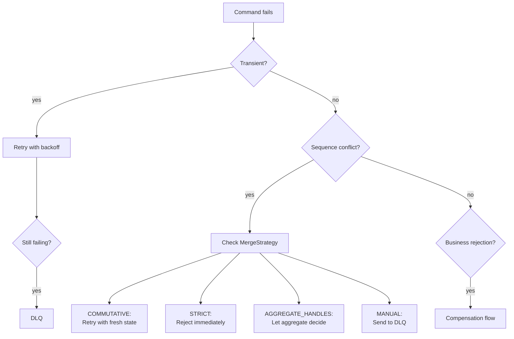

import Tabs from '@theme/Tabs';
import TabItem from '@theme/TabItem';

# Error Recovery

Angzarr provides layered error recovery: automatic retry for transient failures, dead letter queues for persistent failures, and compensation flows for saga rejections.

---

## Overview



---

## Retry with Backoff

Transient failures (network issues, temporary unavailability) are automatically retried with exponential backoff and jitter.

### Default Backoff Policies

| Context | Min Delay | Max Delay | Max Attempts | Jitter |
|---------|-----------|-----------|--------------|--------|
| Saga/PM commands | 10ms | 2s | 10 | Yes |
| gRPC connections | 100ms | 5s | 30 | Yes |

### Retryable vs Non-Retryable Errors

| gRPC Code | Meaning | Retryable? | Action |
|-----------|---------|------------|--------|
| `FAILED_PRECONDITION` | Sequence mismatch (stale client state) | Yes | Fetch fresh state, rebuild command |
| `ABORTED` | Sent to DLQ (MERGE_MANUAL) | No | Manual intervention required |
| `INVALID_ARGUMENT` | Bad command data | No | Fix command, resubmit |
| `NOT_FOUND` | Aggregate doesn't exist | No | Check aggregate ID |
| `INTERNAL` | Server error | No | Check server logs |

### Retry Flow

```
1. Command fails with FAILED_PRECONDITION
2. Error details contain current EventBook
3. Client extracts EventBook from error
4. Client rebuilds state from fresh EventBook
5. Client re-evaluates business logic with fresh state
6. Client builds new command with correct sequence
7. Client resubmits
8. Repeat until success or max attempts
```

:::warning Rebuild, Don't Just Re-sequence
Simply updating the sequence number is insufficient. The command's payload may depend on state that changed. You must rebuild the command by re-running your business logic against the fresh state.
:::

<Tabs groupId="language">
<TabItem value="rust" label="Rust" default>

```rust
// Extract fresh state from sequence mismatch error
fn handle_sequence_error(status: &Status) -> Option<EventBook> {
    if status.code() == Code::FailedPrecondition {
        let details = status.details();
        if !details.is_empty() {
            return EventBook::decode(details).ok();
        }
    }
    None
}

// Retry loop with backoff - rebuilds command from fresh state
async fn execute_with_retry<F>(
    intent: &CommandIntent,       // Original intent (what user wanted)
    build_command: F,             // Function to build command from state
    client: &mut AggregateClient,
) -> Result<EventBook, Status>
where
    F: Fn(&CommandIntent, &EventBook) -> Result<CommandBook, CommandRejectedError>,
{
    let backoff = saga_backoff();
    let mut delays = backoff.build();
    let mut current_state: Option<EventBook> = None;

    loop {
        // Build command from current state (or fetch if first attempt)
        let state = match &current_state {
            Some(s) => s.clone(),
            None => client.get_state(intent.root_id()).await?,
        };

        let command = match build_command(intent, &state) {
            Ok(cmd) => cmd,
            Err(e) => return Err(e.into()), // Business logic rejected
        };

        match client.execute(command).await {
            Ok(events) => return Ok(events),
            Err(status) if status.code() == Code::FailedPrecondition => {
                if let Some(delay) = delays.next() {
                    // Extract fresh state for next iteration
                    current_state = handle_sequence_error(&status);
                    tokio::time::sleep(delay).await;
                } else {
                    return Err(status);
                }
            }
            Err(status) => return Err(status),
        }
    }
}
```

</TabItem>
<TabItem value="python" label="Python">

```python
import grpc
from angzarr_client.proto import EventBook

def handle_sequence_error(error: grpc.RpcError) -> EventBook | None:
    """Extract fresh state from sequence mismatch error."""
    if error.code() == grpc.StatusCode.FAILED_PRECONDITION:
        details = error.trailing_metadata()
        for key, value in details:
            if key == "grpc-status-details-bin":
                return EventBook.FromString(value)
    return None

async def execute_with_retry(
    intent: CommandIntent,            # What the user wanted
    build_command: Callable,          # Function: (intent, state) -> CommandBook
    client: AggregateClient,
    max_attempts: int = 10,
) -> EventBook:
    """Execute command with retry, rebuilding from fresh state each attempt."""
    delay = 0.01
    current_state = None

    for attempt in range(max_attempts):
        # Get state if first attempt, otherwise use state from error
        if current_state is None:
            current_state = await client.get_state(intent.root_id)

        # Rebuild command from current state
        try:
            command = build_command(intent, current_state)
        except CommandRejectedError:
            raise  # Business logic rejected with fresh state

        try:
            return await client.execute(command)
        except grpc.RpcError as e:
            if e.code() == grpc.StatusCode.FAILED_PRECONDITION:
                # Extract fresh state for next attempt
                current_state = handle_sequence_error(e)
                await asyncio.sleep(delay)
                delay = min(delay * 2, 2.0)
            else:
                raise

    raise RuntimeError("Max retry attempts exceeded")
```

</TabItem>
<TabItem value="go" label="Go">

```go
// CommandIntent captures what the user wanted to do
type CommandIntent struct {
    RootID uuid.UUID
    // ... other fields capturing user intent
}

// CommandBuilder rebuilds command from intent and current state
type CommandBuilder func(intent *CommandIntent, state *pb.EventBook) (*pb.CommandBook, error)

// executeWithRetry rebuilds command from fresh state on each retry
func executeWithRetry(
    ctx context.Context,
    intent *CommandIntent,
    buildCommand CommandBuilder,
    client pb.AggregateClient,
) (*pb.EventBook, error) {
    delay := 10 * time.Millisecond
    maxDelay := 2 * time.Second
    maxAttempts := 10
    var currentState *pb.EventBook

    for attempt := 0; attempt < maxAttempts; attempt++ {
        // Get state if first attempt
        if currentState == nil {
            var err error
            currentState, err = client.GetState(ctx, intent.RootID)
            if err != nil {
                return nil, err
            }
        }

        // Rebuild command from current state
        command, err := buildCommand(intent, currentState)
        if err != nil {
            return nil, err // Business logic rejected
        }

        events, err := client.Execute(ctx, command)
        if err == nil {
            return events, nil
        }

        st, _ := status.FromError(err)
        if st.Code() == codes.FailedPrecondition {
            // Extract fresh state for next attempt
            currentState = handleSequenceError(err)
            time.Sleep(delay)
            delay = min(delay*2, maxDelay)
        } else {
            return nil, err
        }
    }

    return nil, fmt.Errorf("max retry attempts exceeded")
}
```

</TabItem>
<TabItem value="java" label="Java">

```java
// CommandIntent captures what the user wanted to do
public record CommandIntent(UUID rootId /* ... other fields */) {}

// Functional interface for building commands from intent and state
@FunctionalInterface
public interface CommandBuilder {
    CommandBook build(CommandIntent intent, EventBook state)
        throws CommandRejectedError;
}

// Execute with retry, rebuilding command from fresh state each attempt
public EventBook executeWithRetry(
        CommandIntent intent,
        CommandBuilder buildCommand,
        AggregateClient client) throws StatusException {

    Duration delay = Duration.ofMillis(10);
    Duration maxDelay = Duration.ofSeconds(2);
    int maxAttempts = 10;
    EventBook currentState = null;

    for (int attempt = 0; attempt < maxAttempts; attempt++) {
        // Get state if first attempt
        if (currentState == null) {
            currentState = client.getState(intent.rootId());
        }

        // Rebuild command from current state
        CommandBook command;
        try {
            command = buildCommand.build(intent, currentState);
        } catch (CommandRejectedError e) {
            throw e; // Business logic rejected with fresh state
        }

        try {
            return client.execute(command);
        } catch (StatusException e) {
            if (e.getStatus().getCode() == Status.Code.FAILED_PRECONDITION) {
                // Extract fresh state for next attempt
                currentState = handleSequenceError(e);
                Thread.sleep(delay.toMillis());
                delay = delay.multipliedBy(2);
                if (delay.compareTo(maxDelay) > 0) {
                    delay = maxDelay;
                }
            } else {
                throw e;
            }
        }
    }

    throw new RuntimeException("Max retry attempts exceeded");
}

private EventBook handleSequenceError(StatusException e) {
    // Extract fresh EventBook from error details
    for (var detail : e.getTrailers()) {
        if (detail.getKey().equals("grpc-status-details-bin")) {
            return EventBook.parseFrom(detail.getValue());
        }
    }
    return null;
}
```

</TabItem>
<TabItem value="csharp" label="C#">

```csharp
// CommandIntent captures what the user wanted to do
public record CommandIntent(Guid RootId /* ... other fields */);

// Delegate for building commands from intent and state
public delegate CommandBook CommandBuilder(CommandIntent intent, EventBook state);

// Execute with retry, rebuilding command from fresh state each attempt
public async Task<EventBook> ExecuteWithRetryAsync(
    CommandIntent intent,
    CommandBuilder buildCommand,
    AggregateClient client,
    int maxAttempts = 10)
{
    var delay = TimeSpan.FromMilliseconds(10);
    var maxDelay = TimeSpan.FromSeconds(2);
    EventBook? currentState = null;

    for (var attempt = 0; attempt < maxAttempts; attempt++)
    {
        // Get state if first attempt
        currentState ??= await client.GetStateAsync(intent.RootId);

        // Rebuild command from current state
        CommandBook command;
        try
        {
            command = buildCommand(intent, currentState);
        }
        catch (CommandRejectedError)
        {
            throw; // Business logic rejected with fresh state
        }

        try
        {
            return await client.ExecuteAsync(command);
        }
        catch (RpcException ex) when (ex.StatusCode == StatusCode.FailedPrecondition)
        {
            // Extract fresh state for next attempt
            currentState = HandleSequenceError(ex);
            await Task.Delay(delay);
            delay = TimeSpan.FromTicks(Math.Min(delay.Ticks * 2, maxDelay.Ticks));
        }
    }

    throw new InvalidOperationException("Max retry attempts exceeded");
}

private static EventBook? HandleSequenceError(RpcException ex)
{
    // Extract fresh EventBook from error details
    var detailsEntry = ex.Trailers.FirstOrDefault(
        t => t.Key == "grpc-status-details-bin");

    if (detailsEntry != null)
    {
        return EventBook.Parser.ParseFrom(detailsEntry.ValueBytes);
    }
    return null;
}
```

</TabItem>
</Tabs>

---

## Dead Letter Queue (DLQ)

Messages that cannot be processed after retries are routed to a dead letter queue for manual intervention.

### When Messages Go to DLQ

| Scenario | MergeStrategy | Result |
|----------|---------------|--------|
| Sequence mismatch | `MERGE_MANUAL` | Immediate DLQ |
| Event handler failed | Any | DLQ after retries |
| Payload retrieval failed | Any | DLQ |
| Max retries exceeded | `COMMUTATIVE` | DLQ |

### Topic Naming

DLQ topics are per-domain for isolation:

```
angzarr.dlq.{domain}
```

Examples:
- `angzarr.dlq.player` — Player domain failures
- `angzarr.dlq.hand` — Hand domain failures
- `angzarr.dlq.table` — Table domain failures

### Dead Letter Structure

```protobuf file=proto/angzarr/types.proto start=docs:start:dead_letter end=docs:end:dead_letter
```

### DLQ Backends

| Backend | Topic Format | Use Case |
|---------|--------------|----------|
| Channel | In-memory | Standalone mode, testing |
| AMQP | `angzarr.dlq` exchange | RabbitMQ production |
| Kafka | `angzarr-dlq-{domain}` | Kafka production |
| Pub/Sub | `angzarr-dlq-{domain}` | GCP production |
| SNS/SQS | `angzarr-dlq-{domain}` | AWS production |

### Configuration

```yaml
dlq:
  backend: amqp  # none | channel | amqp | kafka | pubsub | sns_sqs
  amqp_url: "amqp://localhost:5672"
  # OR
  kafka_brokers: "localhost:9092"
  # OR
  aws_region: "us-east-1"
  aws_endpoint_url: "http://localhost:4566"  # LocalStack
```

### Processing DLQ Messages

Dead letters require manual review. Common actions:

1. **Fix and replay** — Correct the issue, resubmit command
2. **Skip** — Mark as handled without replay (data not critical)
3. **Compensate** — Emit compensating events manually
4. **Escalate** — Route to operations team

---

## Saga Compensation

When a saga-issued command is rejected, angzarr notifies the original aggregate so it can emit compensation events.

### Compensation Flow

```
1. Saga emits command to target aggregate
2. Target aggregate rejects (business rule violation)
3. Framework builds RejectionNotification
4. Framework sends Notification to source aggregate
5. Source aggregate emits compensation events
   OR
   Source aggregate returns RevocationResponse flags
```

### Notification vs Event

| Aspect | Notification | Event |
|--------|--------------|-------|
| Persisted? | No | Yes |
| Sequence? | No | Yes |
| Replay? | No | Yes |
| Purpose | Signaling | State change |

Notifications are ephemeral signals — they trigger behavior but aren't part of the event stream.

### RejectionNotification

```protobuf file=proto/angzarr/types.proto start=docs:start:rejection_notification end=docs:end:rejection_notification
```

### Handling Rejections

The source aggregate registers rejection handlers using `@rejected` decorators. The framework dispatches based on the rejected command's domain and type — no if/else chains needed.

<Tabs groupId="language">
<TabItem value="python" label="Python" default>

**[`examples/python/player/agg/rejected.py`](https://github.com/benjaminabbitt/angzarr/blob/main/examples/python/player/agg/rejected.py)**

```python file=examples/python/player/agg/rejected.py start=docs:start:rejected_handler end=docs:end:rejected_handler
```

</TabItem>
<TabItem value="rust" label="Rust">

**[`examples/rust/player/agg/src/handlers/rejected.rs`](https://github.com/benjaminabbitt/angzarr/blob/main/examples/rust/player/agg/src/handlers/rejected.rs)**

```rust file=examples/rust/player/agg/src/handlers/rejected.rs start=docs:start:rejected_handler end=docs:end:rejected_handler
```

</TabItem>
<TabItem value="go" label="Go">

**[`examples/go/player/agg/handlers/revocation.go`](https://github.com/benjaminabbitt/angzarr/blob/main/examples/go/player/agg/handlers/revocation.go)**

```go file=examples/go/player/agg/handlers/revocation.go start=docs:start:rejected_handler end=docs:end:rejected_handler
```

</TabItem>
<TabItem value="java" label="Java">

```java title="illustrative - rejection handler"
@RejectionHandler("JoinTable")
public FundsReleased handleJoinRejected(RejectionNotification rejection) {
    byte[] tableRoot = rejection.getRejectedCommand().getCover().getRoot().getValue();
    long reserved = state.getTableReservations().get(tableRoot);
    return FundsReleased.newBuilder()
        .setAmount(reserved)
        .setTableRoot(tableRoot)
        .build();
}
```

</TabItem>
<TabItem value="csharp" label="C#">

```csharp title="illustrative - rejection handler"
[RejectionHandler("JoinTable")]
public FundsReleased HandleJoinRejected(RejectionNotification rejection)
{
    var tableRoot = rejection.RejectedCommand.Cover.Root.Value;
    var reserved = State.TableReservations[tableRoot];
    return new FundsReleased { Amount = reserved, TableRoot = tableRoot };
}
```

</TabItem>
</Tabs>

### RevocationResponse Flags

When an aggregate cannot handle a rejection, it returns flags:

| Flag | Effect |
|------|--------|
| `emit_system_revocation` | Emit `SagaCompensationFailed` event to fallback domain |
| `send_to_dead_letter_queue` | Route to DLQ for manual review |
| `escalate` | Trigger webhook notification |
| `abort` | Stop saga chain, propagate error to caller |

---

## MergeStrategy and Conflicts

The `MergeStrategy` enum controls how sequence conflicts are handled:

| Strategy | Proto Value | Behavior on Conflict |
|----------|-------------|----------------------|
| `MERGE_COMMUTATIVE` | 0 (default) | `FAILED_PRECONDITION` — retryable with fresh state |
| `MERGE_STRICT` | 1 | `ABORTED` — immediate rejection, no retry |
| `MERGE_AGGREGATE_HANDLES` | 2 | Bypass validation — aggregate decides |
| `MERGE_MANUAL` | 3 | `ABORTED` + route to DLQ |

### When to Use Each

| Use Case | Strategy | Why |
|----------|----------|-----|
| Financial operations (balance checks) | `STRICT` | Must see current state |
| Counters, metrics | `COMMUTATIVE` | Order doesn't matter |
| CRDT-style operations | `AGGREGATE_HANDLES` | Aggregate merges conflicts |
| Auditable operations | `MANUAL` | Human review required |

### MERGE_MANUAL Flow

```
1. Command arrives with MERGE_MANUAL
2. Coordinator detects sequence mismatch
3. Command NOT executed
4. AngzarrDeadLetter created with SequenceMismatchDetails
5. Published to DLQ topic
6. Returns ABORTED status to caller
```

---

## Escalation

For critical failures, angzarr can trigger alerts via webhooks:

Webhook payload:

```json
{
  "saga_name": "saga-table-player",
  "triggering_aggregate": {
    "domain": "table",
    "root": "550e8400-e29b-41d4-a716-446655440000"
  },
  "triggering_sequence": 5,
  "rejection_reason": "insufficient_funds",
  "compensation_reason": "Aggregate returned empty response",
  "occurred_at": "2024-01-15T10:30:00Z"
}
```

---

## Best Practices

### 1. Design for Idempotency

Handlers may be retried. Ensure repeated execution produces the same result.

```python
# BAD: Not idempotent
def apply_funds_deposited(state, event):
    state.balance += event.amount  # Adds again on retry!

# GOOD: Idempotent (events have absolute values)
def apply_funds_deposited(state, event):
    state.balance = event.new_balance  # Same result on retry
```

### 2. Use Appropriate MergeStrategy

```python
# Financial operations: STRICT
@merge_strategy(MergeStrategy.STRICT)
def handle_transfer(state, cmd):
    if cmd.amount > state.available:
        raise CommandRejectedError("insufficient_funds")

# Counters: COMMUTATIVE
@merge_strategy(MergeStrategy.COMMUTATIVE)
def handle_increment(state, cmd):
    return ValueIncremented(delta=cmd.delta)

# Audit-critical: MANUAL
@merge_strategy(MergeStrategy.MANUAL)
def handle_compliance_action(state, cmd):
    return ComplianceActionTaken(action=cmd.action)
```

### 3. Handle Notifications Explicitly

Don't ignore `RejectionNotification` — either compensate or escalate:

```python
def handle_rejection(state, rejection):
    if can_compensate(rejection):
        return build_compensation_event(rejection)
    else:
        return RevocationResponse(
            send_to_dead_letter_queue=True,
            escalate=True,
            reason="Cannot compensate automatically",
        )
```

### 4. Monitor DLQ Depth

Set up alerts for DLQ message accumulation:

```yaml
# Prometheus alert
- alert: DLQBacklog
  expr: dlq_messages_total > 100
  for: 5m
  labels:
    severity: warning
```

---

## Next Steps

- **[Patterns Reference](/reference/patterns)** — MergeStrategy, SyncMode details
- **[Sagas](/components/saga)** — Cross-domain coordination
- **[Payload Offloading](/operations/payload-offloading)** — Large message handling
